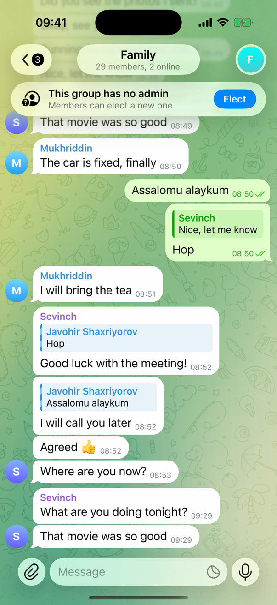
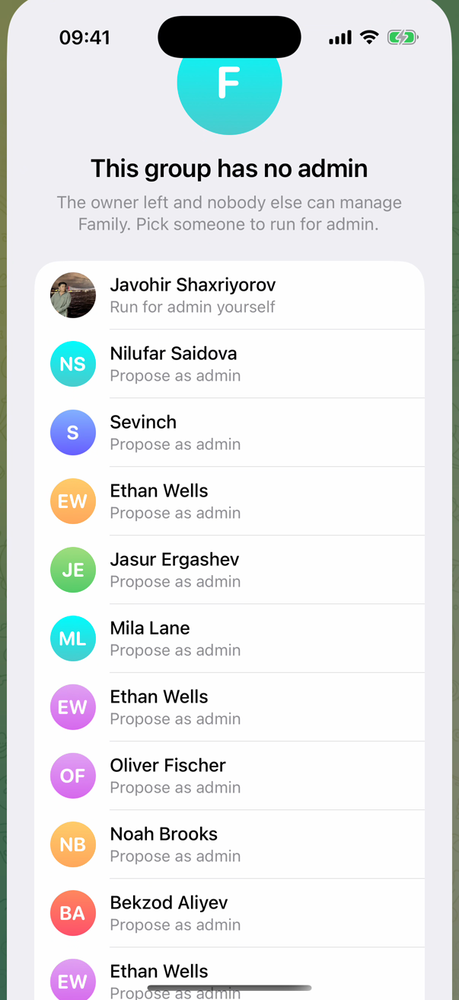
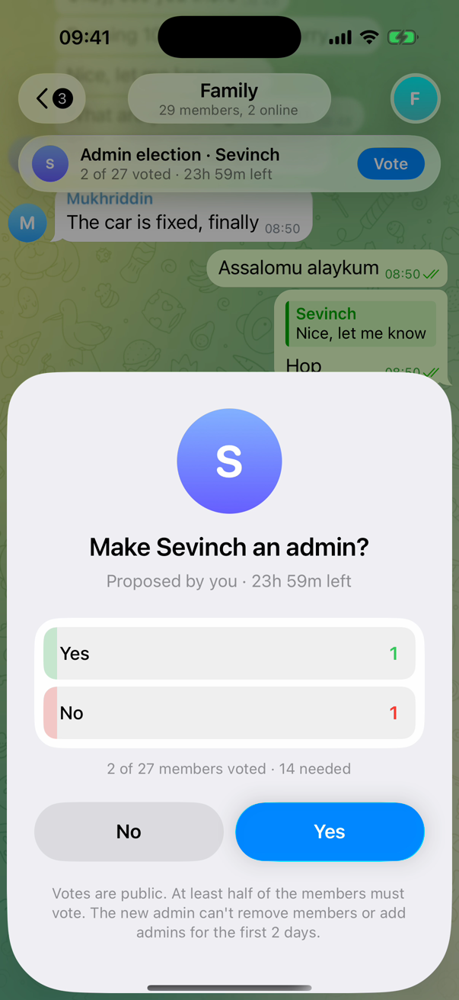
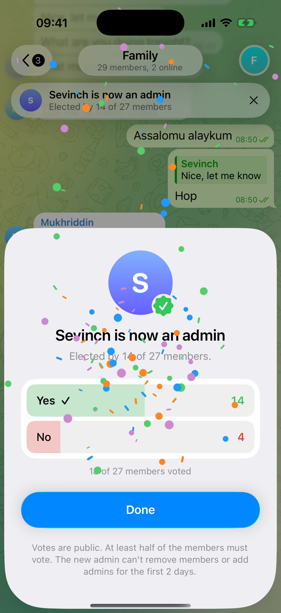
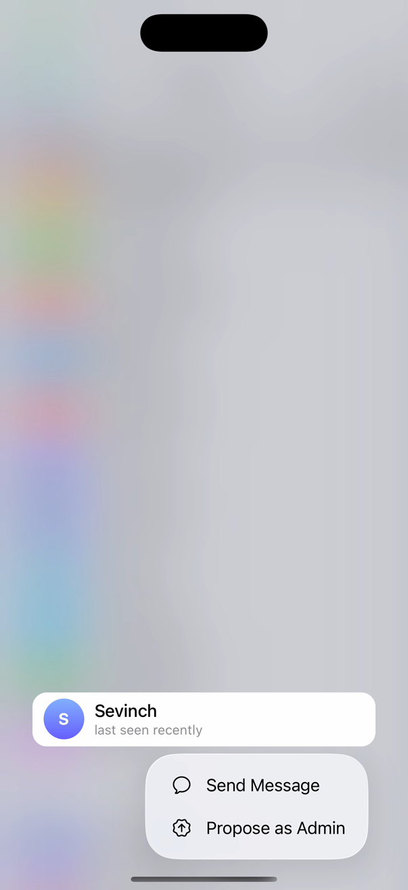
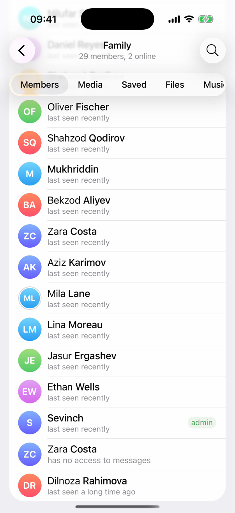
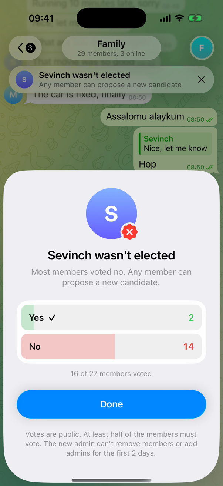
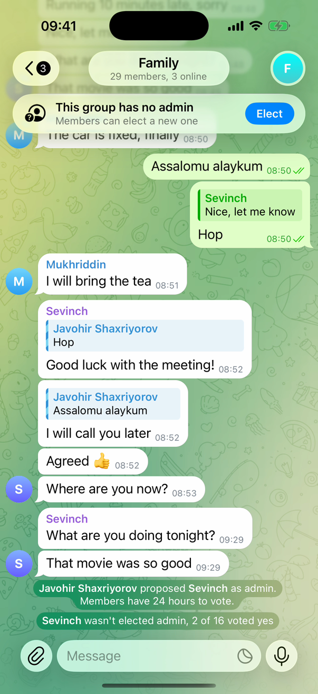

# Admin Elections for basic groups

When the owner of a basic group deletes their account or leaves, and nobody else is an admin, the group can never be managed again. Members can elect a new admin from among themselves with a public Yes / No vote.

**Basic groups only, not supergroups.** Supergroups already let an owner transfer ownership and keep their admins when the owner leaves.

▶︎ [Media/demo.mp4](Media/demo.mp4): four flows in 76 seconds, recorded on the iOS app built from this code.



---

## 1. The problem

A basic group is the default Telegram group: family chats, classmates, a building's neighbours. Most of them are created by one person and never get a second admin.

When that person **deletes their account** (or leaves and never comes back), the group keeps living but nobody can:

- change its name, photo or description,
- remove a spammer or someone who was added by mistake,
- pin a message, change the permissions or add an admin.

There is no recovery path today. The only option for the members is to create a new group and invite everyone again, losing the history, the media and the people who don't notice the move.

## 2. Why it is worth solving

- **It happens to real, active groups.** Accounts are deleted on purpose, by inactivity self-destruct, or because a phone number changed hands. The group outlives its owner.
- **The members are the only ones who know the group.** A vote among them is the fairest way to choose who manages it, and it needs no support ticket or manual review.
- **It is small.** One banner, one sheet, one item in an existing menu. Nothing changes for groups that have an admin.

## 3. How it works

### The flow

| | |
|---|---|
|  | **A banner appears** in a basic group with no active admin: *This group has no admin · Elect*. |
|  | **Pick a candidate.** *Elect* opens a sheet listing the members. The account is first: anyone can run for admin themselves. |
|  | **The sheet turns into the vote** in place. Everyone eligible sees *Make Sevinch an admin?* with Yes / No, live results, the turnout and the time left. |
|  | **Elected.** Every member gets the result as a modal with confetti, and the chat gets a service message. |
|  | **Or propose from the member list.** Long-press a member in Group Info → *Propose as Admin* (*Propose Myself as Admin* on your own row). |
|  | **The new admin** shows up in the member list with the *admin* tag. |
|  | **Not elected.** If most members vote no, or too few vote, nobody is promoted and anyone can propose someone else. |
|  | **Service messages** record who proposed whom and how it ended. |

### The rules

| Rule | Value |
|---|---|
| Duration | 24 hours |
| Quorum | at least half of the eligible members vote |
| Winning | more Yes than No (a tie loses) |
| Small groups | with fewer than 3 voters, everyone has to vote Yes |
| Who can vote | members who joined at least 3 days before the vote; not bots, not deleted accounts, not the candidate |
| Early result | the vote closes as soon as the remaining votes can no longer change the outcome |
| Probation | the elected admin cannot remove members or add admins for the first 48 hours |
| Votes | public |

All rules live in one pure Swift file, [`GroupAdminElectionCore.swift`](GroupAdminElection/Core/GroupAdminElectionCore.swift), with no UI or network dependencies, so the server can run exactly the same logic.

## 4. Conflicts and how they are resolved

| # | Situation | Resolution |
|---|---|---|
| 1 | **When does a group count as having no admin?** A basic group's creator can come back after leaving. | Only when no admin is left **and** the creator deleted their account, or left at least 7 days ago. |
| 2 | **Two elections at once** | One open election per group. A second proposal is refused with *An election is already in progress*. |
| 3 | **Spam proposals** | A member can propose once every 24 hours. A candidate who lost can't be proposed again for 7 days. |
| 4 | **Raids: adding fake accounts to win** | Only members who joined at least 3 days **before** the vote started can vote. The voter list is fixed when the vote starts. |
| 5 | **Deleted accounts inflate the quorum** | Deleted accounts and bots are not counted. |
| 6 | **Tiny groups: one person elects themselves** | Self-nomination is allowed, but the candidate never votes in their own election. With fewer than 3 voters, every voter must say yes. |
| 7 | **A tie** | It loses. Nobody is promoted. |
| 8 | **The candidate leaves during the vote** | The vote is cancelled. |
| 9 | **A voter leaves during the vote** | Their vote is removed and they leave the voter list. |
| 10 | **The old owner comes back, or an admin appears** | The vote is cancelled: the group has an admin again. |
| 11 | **The group is upgraded to a supergroup** | The vote is cancelled. Supergroups have their own admin system. |
| 12 | **The new admin immediately removes everyone** | 48-hour probation: no removing members, no adding admins. |
| 13 | **The elected admin turns out badly** | The same mechanism can remove them: a recall vote with the same rules. |
| 14 | **Forged votes** | Votes are not a regular poll. They are a dedicated server object; the client only renders the state the server sends. |
| 15 | **Anonymous or public?** | Public. Choosing an admin is a collective decision, and visible votes discourage manipulation. The proposer is shown too. |
| 16 | **Old app versions** | They show a service message, *Update Telegram to vote*. |
| 17 | **Notification spam** | One notification when the vote starts, one reminder an hour before it ends, only for members who haven't voted. |
| 18 | **Nobody waits 24 hours for an obvious result** | The vote closes as soon as the remaining votes can no longer change the outcome. It does not close the moment the quorum is reached, because late No votes could still flip it. |

Rows 1–12 and 18 are implemented in the core and covered by the unit tests in [`GroupAdminElectionCoreTests.swift`](GroupAdminElection/Tests/GroupAdminElectionCoreTests.swift). Rows 13–17 describe what the server and notifications should do.

## 5. Proposed server API

The client is written against a small service, so plugging in the server touches nothing else:

```
messages.proposeChatAdmin chat_id:long user_id:InputUser = Updates;
messages.voteChatAdmin chat_id:long election_id:long yes:Bool = Updates;
messages.getChatAdminElection chat_id:long = messages.ChatAdminElection;

updateChatAdminElection chat_id:long election:ChatAdminElection = Update;
messageActionChatAdminElectionStarted candidate_id:long = MessageAction;
messageActionChatAdminElected user_id:long yes:int no:int = MessageAction;
```

`chatFull` gets a `can_elect_admin` flag (the server knows when the creator left, the client doesn't).

## 6. Repository

| Path | What |
|---|---|
| `GroupAdminElection/` | Drop-in module for `submodules/TelegramUI/Components/GroupAdminElection` |
| `GroupAdminElection/Core/GroupAdminElectionCore.swift` | The rules: eligibility, quorum, early outcome, cooldowns, membership changes. Pure Swift. |
| `GroupAdminElection/Tests/GroupAdminElectionCoreTests.swift` | 9 unit tests for the rules |
| `GroupAdminElection/Sources/GroupAdminElectionService.swift` | Client state per group. Until the API exists it plays the server's part locally (see *Limitations*). |
| `GroupAdminElection/Sources/GroupAdminElectionScreen.swift` | The sheet: candidate list, vote, results, celebration |
| `GroupAdminElection/Sources/GroupAdminElectionProposal.swift` | *Propose as Admin* from the member list: confirmation and error messages |
| `GroupAdminElection/Sources/GroupAdminElectionDemoTouches.swift` | Draws touches for screen recordings (demo mode only) |
| `Integration/ChatAdminElectionTitlePanelNode.swift` | The banner on top of the chat. Goes to `submodules/TelegramUI/Sources/` |
| `Integration/changes.patch` | Changes to existing files, see below |
| `Media/` | Demo video and screenshots |

### Changes to existing files (`Integration/changes.patch`)

| File | Change |
|---|---|
| `ChatPresentationInterfaceState.swift` | New title panel context `.adminElection` |
| `ChatInterfaceTitlePanelNodes.swift` | Shows `ChatAdminElectionTitlePanelNode` for it |
| `ChatController.swift`, `ChatControllerLoadDisplayNode.swift` | Observe the election state of a basic group; present the result modal |
| `PeerInfoScreenOpenMember.swift` | *Propose as Admin* in the member context menu |
| `PeerInfoMembers.swift` | The elected member is listed as admin |
| `TelegramEngineMessages.swift` | `addLocalServiceMessage`, for the service messages until the server sends them |
| `AppDelegate.swift` | Turns on touch drawing in demo mode |
| `TelegramUI/BUILD`, `PeerInfoScreen/BUILD` | Module dependencies |

The patch is made against [TelegramMessenger/Telegram-iOS@f1dd7a2](https://github.com/TelegramMessenger/Telegram-iOS/commit/f1dd7a2dbd).

## 7. Trying it

```sh
cp -R GroupAdminElection <Telegram-iOS>/submodules/TelegramUI/Components/
cp Integration/ChatAdminElectionTitlePanelNode.swift <Telegram-iOS>/submodules/TelegramUI/Sources/
cd <Telegram-iOS> && git apply <this repo>/Integration/changes.patch
```

Build as usual. To see the whole flow on one device, turn on demo mode on the simulator:

```sh
xcrun simctl spawn booted defaults write ph.telegra.Telegraph GroupAdminElectionDemo -bool YES
```

Then open a basic group whose creator left. In demo mode the other members cast simulated votes a moment apart (`GroupAdminElectionDemoVoteInterval`, seconds; `GroupAdminElectionDemoYesShare`, 0…1), members who joined recently can vote, and touches are drawn on screen.

Unit tests (host, no simulator):

```sh
bazel test //submodules/TelegramUI/Components/GroupAdminElection:GroupAdminElectionCoreTests
```

## 8. Limitations

1. **The server doesn't support elections yet.** Promoting a member needs an admin today, so `GroupAdminElectionService` plays the server's part: elections are kept in memory on this device, other members don't see them, and the elected admin is shown as admin locally only. The service messages are local messages. Everything that renders an election reads it from the service, so replacing it with the API above changes nothing else.
2. **"The creator left at least 7 days ago" can't be checked on the client.** The client only sees that the creator is no longer a member. The server should decide and send `can_elect_admin`.
3. **Strings are in English.** They are not in `Localizable.strings` yet.
4. **The names in the demo are stand-ins.** The video was recorded on a real account, with other people's names, photos and messages replaced on the device.
